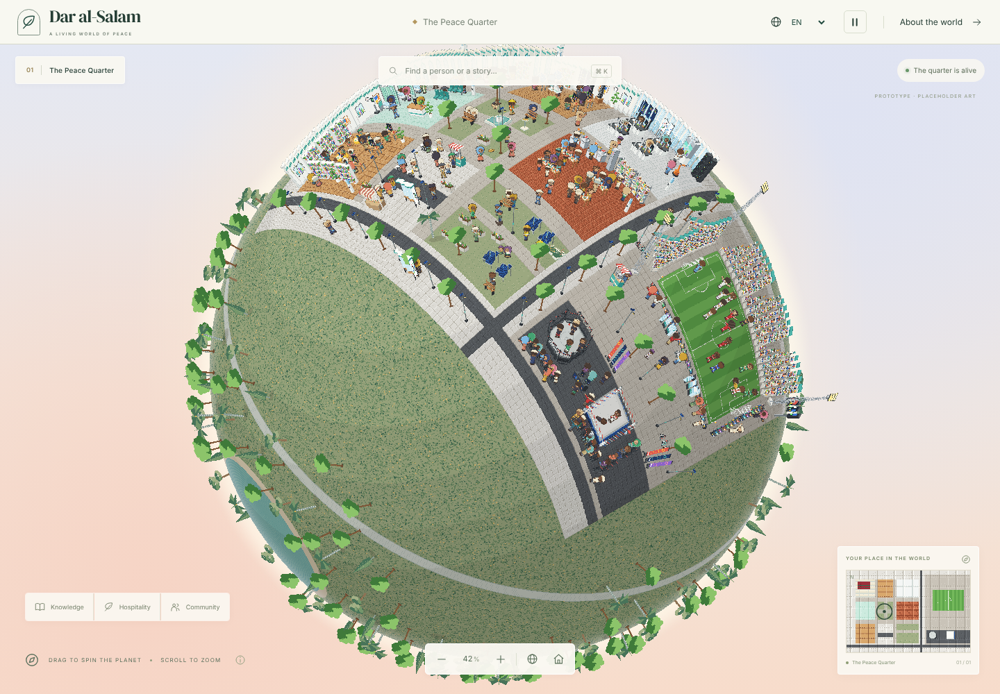

# Dar al-Salam

An explorable pixel-art **little planet** about knowledge, hospitality, mercy and everyday care. Drag to spin the globe; zoom in to look across its curving surface. The first room, **The Peace Quarter**, is a modern Muslim neighbourhood wrapped onto the planet, with thirty-seven draft cards and no background people (only main characters), plus a Bangladesh block with Baitul Mukarram, a school, cricket and everyday life. Sport and public life: Karim Benzema, Mesut Özil, Mohamed Salah, Sadio Mané, N’Golo Kanté, Khabib Nurmagomedov, Islam Makhachev, Kamaru Usman, Zabit Magomedsharipov, Khamzat Chimaev, Muhammad Ali, Zohran Mamdani and Abdul El-Sayed. Science and design: Fazlur Rahman Khan, Zaha Hadid, Aziz Sancar and Ahmed Zewail. Today's scholars: Mufti Ismail Menk, Hamza Yusuf, Omar Suleiman and Habib Umar bin Hafiz. Bangladesh: Kazi Nazrul Islam, Begum Rokeya, Mashrafe Mortaza and Tamim Iqbal, with Malala Yousafzai visiting the school. Also Hakeem Olajuwon and the traveller Ibn Battuta. Golden-age scholars: Al-Khwarizmi, Ibn Sina, Fatima al-Fihri, Ibn al-Haytham, al-Zahrawi, al-Jazari, al-Biruni, Ibn Khaldun and Ibn Rushd. Named people have sharp heads drawn at twice the resolution, so their faces can be recognised. Characters and buildings are drawn in a detailed, realistic pixel-art style in the spirit of the reference screenshots: adult proportions, faces whose expressions change with what people are doing, and shaded hair and clothing; hovering anyone shows a short label ("Nurse caring for patients"). The reference screenshots informed density and the small-planet idea; all artwork here is original procedural placeholder art, not extracted from those images.



The scene has 183 room objects across ten zones: a modern mosque with a prayer hall and Qur'an study circle, an architecture studio, a university science lab, a hospital, a central park with a fountain, a community kitchen, a library with a children's coding class, a street with a café and bus stop, and a solar garden, plus a football stadium east of the ring road (pitch, crowded stands, floodlights, dugouts). In the stadium Karim Benzema loops through a finger-to-the-sky celebration, arms-wide cheer and folded arms, Mohamed Salah holds his arms-out pose beside Sadio Mané (hand on heart) at the centre circle, N’Golo Kanté dribbles non-stop through midfield in Chelsea blue, each player in his club's kit colours, and Mesut Özil's chip-and-stop goal plays out every 20 seconds: the keeper rushes out, the chip, control on the bounce, two defenders sliding past, and the roll into the empty net. South of the quarter is a slice of New York City (brownstones, an Art Deco tower, glass towers, City Hall, a bodega, a halal cart, a subway entrance and yellow taxis) where Mayor Zohran Mamdani scoots round the City Hall block and waves, and a Michigan victory rally where Senator-elect Abdul El-Sayed speaks from a podium to a cheering crowd. South of the stadium a fight-night arena holds a cage octagon and a raised boxing ring. Khabib Nurmagomedov stands in the octagon in his papakha with the title belt while Islam Makhachev and Kamaru Usman trade jabs, Zabit Magomedsharipov kicks and Khamzat Chimaev shadowboxes ringside, and Muhammad Ali stands over a fallen opponent in the ring in his famous pose. The ball is its own animated object (`kind: "ball"`) with height for the chip, so its shadow stays on the grass. Characters are drawn on a 56×84 canvas (adults about 64 px tall). The world opens at 2× zoom, with the introduction available through the information button so the scene fills the screen.

## Run

Requires Node 24 and pnpm 11.25.0 (pinned for Vercel and local builds).

```sh
pnpm install --frozen-lockfile
pnpm dev
```

Vite serves the application on port 5173. On first run, missing placeholder art is generated and development assets are built automatically. No account, API key, database, analytics or backend service is needed. Google Fonts is the only optional external application request; system font fallbacks work offline.

```sh
pnpm gen:placeholder       # seed missing source art/content; preserve existing authored content
pnpm build:assets          # validate and bake development assets
pnpm build:preview         # static REVIEW build, allows draft cards; output: dist/
pnpm build:assets --prod   # enforce advisory approval (expected to fail on the sample cards)
pnpm build                # production assets + Vite; same deliberate approval gate
pnpm test                 # shared math, content, script, compositor and pipeline tests
pnpm typecheck
pnpm lint
pnpm format
```

`pnpm build` intentionally fails while the example cards have `panelApproved: false`. Do not change those flags to make a build green. Use the development workflow or `build:preview` for prototype review. All biographies, stories and sources are explicitly unresearched placeholders.

## Deploy to Vercel

See [VERCEL.md](VERCEL.md). The repository-root configuration installs pinned pnpm, builds `dist/`, and rewrites character/about/list deep links. Both Vercel **Preview** and **Production** hosting deploy the labelled prototype by default, with the historical cards still marked **DRAFT**. Hosting on a production URL does not approve the content. Use `pnpm build` (or explicitly set `DAR_CONTENT_MODE=approved`) for a reviewed release; that strict build still rejects unapproved cards.

## Explore

- Drag with mouse/touch to spin the planet (north stays up); use the wheel or pinch to zoom. Arrow keys spin, +/− zoom, and the globe button shows the whole planet. On phones the world opens at 100% (people readable) and zooms out to 5%. The spin keeps inertia after dragging. Zooms of at least 1× snap to integer levels when idle.
- Hover anyone to see what they are doing; named people (outlined in gold) open a story card when clicked.
- Search names or aliases in any of the three languages. Select a result to fly to the character and open its draft card. Opaque sprite pixels are clickable; transparent pixels and ambient characters are not.
- Pause/resume with the top-bar button. Reduced-motion preferences freeze the world automatically. The entire simulation repeats every 240 frames (20 seconds at 12 fps).
- Click/drag the minimap to navigate. Camera state is encoded in `?x=&y=&z=` (world-centre coordinates); `/c/<id>` loads a selected character directly.
- EN / العربية / বাংলা changes UI language. Arabic mirrors the interface. `/list` presents all named characters as accessible HTML; `/about` explains content rules.
- Development only: press **I** for grid, collision, paths, footprints, strip bounds, depths, pair links, foot anchors and hovered hit-mask inspection. Visit **`/lab`** for the Character Lab. Neither developer route is exposed in a static review/production build.
- Offline panel review: `public-build/review/characters.html` contains all used actions, facings and unique frames, with draft and prayer-review flags.

## Architecture

- `packages/shared/`: strict zod schemas; coordinates; deterministic script evaluation; global clock; name rules; raw-pixel compositor; Aseprite importer; hit masks; spatial grid; LRU; URL helpers. No React.
- `tools/placeholder/`: seeded raw-pixel art generator and sample room/content. Parts use the same Aseprite JSON-array export format as artist assets. No sacred text or symbols are generated.
- `tools/build/`: validation, palette checks, composition, mirroring, tint ramps, outline/shadow, tight bounds, alpha masks, SHA-256 frame deduplication, 16 px object slices, 2048 px atlas packing with padding/extrusion, a top-down tile-space ground texture (`ground.webp`, 16 texels per tile), planet decorations and manifest generation.
- `web/src/engine/`: PixiJS v8 planet engine: a GLSL shader draws the sphere (wrapping `ground.webp` onto it, plus grass, lakes and a ring road elsewhere, with lighting and a halo); every object strip and character is a billboard projected onto the surface and leaned outward toward the horizon; globe spin/zoom/pinch with inertia; depth sorting by camera depth; rotated pixel-accurate hit testing; inspector. No React imports.
- `packages/shared/planet.ts`: the tile ↔ sphere mapping (azimuthal equidistant around tile (50, 30), radius 44 tiles), the north-up camera that looks at the focus point from 30° above its horizon (the same angle as the isometric art), billboard rotation and camera-dependent facing choice.
- `web/src/ui/`: React 18 UI, Tailwind foundation, Zustand store and shared-compositor Character Lab.
- `rooms/mosque-garden.tmj`: Tiled-compatible isometric map. Object x/y are tile coordinates in this prototype; the importer uses those coordinates directly. Footprints are in tile units. Footprint collision is added during build; walkable carpets do not block.
- `web/public/world/` and `public-build/`: ignored build outputs. Source PNG/JSON part sheets, room and seed content are tracked. Built outputs are reproducible and should not be edited.

Content is still authored in tile space (scripts, collision, objects), so every validator and generator works unchanged; only rendering wraps it onto the planet. Every action is baked in all four facings, and the engine picks the one the camera sees, except that `back` characters are only ever shown from behind. Live character updates happen only on 12 fps clock ticks or camera/interaction changes; the camera and Pixi render loop run independently.

## Add a named character

1. Copy a JSON in `content/characters/`; use a unique ID, translated name, aliases, district, `look`, 60/120/240-frame loop and script.
2. Leave `panelApproved: false`. Keep biography/story as `PLACEHOLDER — to be researched` until human research is complete. Include at least two source entries and clearly label placeholders; do not fabricate citations.
3. Set `depiction` to `full` or `back`. Every stationary or moving facing of a `back` character must be NE/NW.
4. Give the person a sharp head: add a painter to a group file in `tools/placeholder/portraits/` (start with `portrait({...traits})` from `face.ts`), then run `pnpm gen:placeholder` (or `--refresh` to redraw existing heads). Without a head the person still works, with a normal-resolution face.
5. Run `pnpm build:assets`; inspect the contact sheet and world. Advisory review is required before production approval.

The denylist applies to IDs, all translated names and aliases on named **and ambient** characters. Accents, punctuation and leading al-/el- are normalised. Full names and given-name tokens before a lineage separator are checked; a later scholar's patronymic does not identify the scholar as a prophet. Exact full-name exceptions are stored in `content/rules/never-depict.json`; the seeded Al-Khwarizmi exception is not a general exemption for the name Muhammad. Only the advisory panel should approve new exceptions.

## Add ambient characters and scripts

Edit `content/ambient/mosque-garden.json`. A character has a resolved `look`, or a build-time `variant: {"fromTemplate":"worshipper","seed":7}`. The resolved look is serialized to the runtime manifest. Animal bases use their matching `cat_*` / `bird_*` actions and `none` garments/headwear/props.

```json
{
  "id": "amb-garden-helper",
  "kind": "person",
  "variant": { "fromTemplate": "worshipper", "seed": 7 },
  "loop": 120,
  "script": [
    {
      "from": 0,
      "to": 60,
      "action": "walk",
      "path": [
        [28, 27],
        [32, 27]
      ]
    },
    {
      "from": 60,
      "to": 120,
      "action": "walk",
      "path": [
        [32, 27],
        [28, 27]
      ]
    }
  ]
}
```

Steps cover 0…loop without gaps/overlaps. Consecutive positions, including the loop boundary, must coincide. Walking/carrying speed cannot exceed one tile per four frames. Paths are sampled for collision; errors identify the first blocked tile. Add `pairWith` for inspector links. A moving step may have a scalar `z` or one z per waypoint. Stationary steps use `at` plus `facing`; moving steps use a polyline instead. Available loop lengths divide the 240-frame master cycle.

## Colour keys and art replacement

See [art/README.md](art/README.md) for the complete Aseprite export convention. `content/palettes/key-colours.json` contains reserved colour ramps. Character looks choose named ramps from `ramps.json`; the compositor replaces every key shade and validates final pixels against the master world palette. Source parts may use keys plus fixed palette colours only. Palette errors report file and pixel coordinates.

The Character Lab loads the same source sheets and calls the same pure RGBA compositor as Node; the browser canvas and sharp adapters only transfer pixels. It includes every colour slot, action/facing, 1×/2×/4×/8× scale, playback/step, anchors, trimmed bounds, mask and JSON copy. Wardrobe options are loaded from the same region configuration as validation.

## Browser verification

Start `pnpm dev` in another terminal, then:

```sh
CHROMIUM_PATH=/usr/bin/chromium pnpm test:e2e
```

The supplied Playwright configuration uses an installed Chromium. Change `CHROMIUM_PATH` to your browser executable. Browser tests cover world loading, search/deep links, opaque vs transparent clicks, camera/overview/inspector, RTL/Bangla, the Lab and a narrow mobile viewport. Screenshots are written under ignored `.playwright/`.

## Content boundaries and prototype limitations

The content rules in [AGENTS.md](AGENTS.md) are mandatory. There are no depictions of prophets, Ahl al-Bayt, the Prophet's wives, Maryam or Companions; no sacred text; faces are stylised cartoon faces without realistic detail. Prayer poses are intentionally simple placeholders, flagged `needsPanelReview`, and require advisory/art review.

This is a functional foundation with procedural art, not the hand-drawn density or visual richness of the reference images. Named cards are drafts. Translations are prototype UI copy pending human proofreading. There is no persistence beyond URL/language settings and no backend. The developer performance display reports FPS, visible character count and instrumented WebGL draw calls; device-specific 60 fps and Android GPU performance require physical-device profiling. Approved-content release builds are deliberately gated on panel approval; public prototype deployments retain their draft labels.

## Refresh the procedural placeholder world

`pnpm gen:placeholder --refresh` regenerates the placeholder part sheets, modern objects, floor tiles, the room layout (`tools/placeholder/modern-quarter.ts`), the ambient people, the draft named cards and the sharp heads in `art/heads/`. It **overwrites** those files, so back up artist-authored replacements first. It never approves a card. Plain `pnpm gen:placeholder` (and `pnpm dev`) only seeds missing files.

- `tools/placeholder/parts.ts` — paper-doll parts drawn from one shared pose skeleton per action/facing/frame.
- `tools/placeholder/modern.ts` and `iso-draw.ts` — the modern district's objects (`m-*`) and tiles 7–13.
- `tools/placeholder/modern-quarter.ts` — zones, objects, people, routes and draft cards; it runs the script validator on every character before writing.
- `node --import tsx tools/placeholder/character-preview.ts <out.png>` and `modern-preview.ts <out.png>` render contact sheets for quick visual checks.
