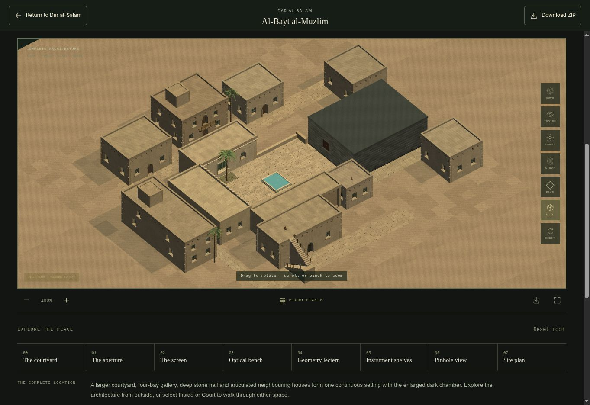
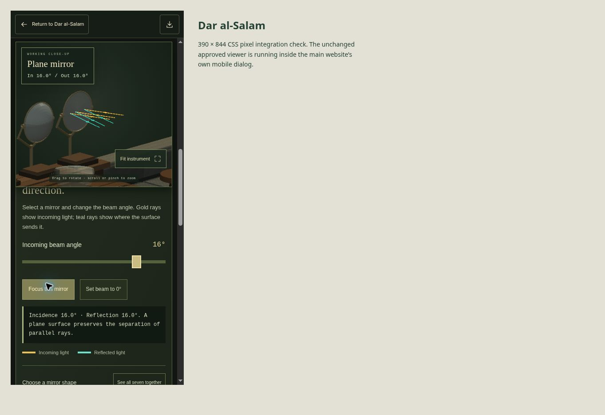

# The approved dark-room exhibit

The full interactive Al-Bayt al-Muzlim design lives inside Dar al-Salam at
`web/public/exhibits/al-bayt-al-muzlim/`. It is a copy of the approved exhibit,
including the enlarged equipment, spacious chamber, courtyard, surrounding
buildings, original rendering, working demonstrations, model downloads and
previews. Its entrypoint is `index.html` in that directory.

The main website opens this exhibit through `/?exhibit=dark-room`. The host
provides the exhibit frame and return controls, suspends world activity while
it is open, and retains the world camera for the return journey. The exhibit
loads from the same website; it does not depend on an authenticated external
Site iframe.

## Approved source and fidelity

The approved source is the `dist/` directory at approved source commit
`c784d7c27a8120d85242175641b029ddfbd12285` from
<https://al-bayt-al-muzlim-pixel-atelier.f-r-tusher007.chatgpt.site/>.

`approved-source.json` records the source identity, exact byte lengths and
SHA-256 checksums of every copied file. The original files are intentionally
unchanged. Host navigation and lifecycle behavior belong outside the exhibit
directory so they cannot silently change the approved art or controls.

The complete and cutaway GLBs exceed the repository connector's 16 MiB
request limit when base64 encoded. Their exact bytes are already contained in
the approved ZIP. `tools/prepare-dark-room-exhibit.mjs` restores those two files
from that archive before development or either build mode. It checks the
archive and model hashes against `approved-source.json`; the models are not
regenerated or re-exported. The extracted files are ignored by Git, and Vite
copies the restored originals into the deployed static assets. All other
approved files, including the unchanged ZIP, are stored directly in Git.

The live exhibit builds its own meshes and procedural textures. It does not
load a GLB to draw the interactive scene. The same source supplies the room,
courtyard, neighboring architecture, furniture, instruments, collisions,
camera presets and teaching demonstrations.

| Files                                          | Responsibility                                                                               |
| ---------------------------------------------- | -------------------------------------------------------------------------------------------- |
| `scene.js`, `courtyard.js`                     | Room, original furnishings, outdoor architecture and navigation                              |
| `instruments.js`, `observation-instruments.js` | Enlarged mirror, tube, astronomy and clock geometry                                          |
| `instrument-experiments.js`                    | Mirror ray intersections, sighting alignment and shadow calculations                         |
| `renderer.js`, `software.js`                   | Approved lighting, materials, pixel sampling, projection, camera framing and Canvas fallback |
| `app.js`, `index.html`, `style.css`            | Working controls, live readouts, picture selectors and responsive layout                     |
| `assets/`                                      | Original model/ZIP downloads, source validation, favicon and approved browser previews       |

All runtime modules and assets use local relative paths. There are no new
runtime dependencies, remote fonts or downloaded textures. The existing Book,
Scholar and Workshop navigation links and the historical source links still
lead to their separate websites.

## The world representation and the full exhibit

The repository's existing `tools/prepare-dark-room.ts` pipeline renders a
cutaway GLB through `tools/dark-room/render.html` into PNG pieces for the
rotatable pixel world. That pipeline applies its own projection, ground scale
and vertical scale, splits large surfaces into sprite strips, and has separate
character/bench composition. It is a different presentation pipeline from the
approved interactive exhibit.

Consequently, a GLB import or a sprite representation alone cannot guarantee
the approved render. The full exhibit preserves the original geometry,
lighting shader, reflective and glass highlights, fine pixel sampling,
inverted courtyard projection, camera presets and dynamic experiment parts.
Use this source as the authoritative close-up experience. Evaluate any world
landmark or sprite updates separately against the same approved design rather
than treating a successful GLB load as proof of visual fidelity.

Pixel-level screenshot comparison also requires the same renderer backend,
viewport size, device-pixel ratio, camera preset, pixel-detail setting and
experiment values. Different aspect ratios intentionally change the camera
fit so the equipment stays readable.

## Runtime isolation

Keep the exhibit in its own same-origin browsing context. Its stylesheet
contains document-wide selectors and `app.js` binds its own element IDs,
keyboard handlers, timers and canvas. Directly importing that application into
the main React document would create CSS and input conflicts.

The host must stop world input/rendering while the exhibit has focus, provide
an accessible return control, permit fullscreen/downloads, and unmount the
exhibit frame when closing it. Removing the frame releases its WebGL context,
animation loop and timers. Merely hiding a frame can leave work running.

The world remains on its existing deterministic 12-Hz, 240-tick simulation.
The isolated exhibit retains its approved interactive clock playback and
camera animation. Those controls are not imported into the world simulation.
No character approvals, biographies or depiction allowlists are changed by
this integration.

## What the downloads contain

- `al-bayt-al-muzlim-collection.zip`: 7,363,028 bytes, below 30,000,000 bytes.
- `al-bayt-al-muzlim-complete.glb`: complete architecture and equipment.
- `al-bayt-al-muzlim-cutaway.glb`: open chamber and the full exterior setting.
- `al-bayt-al-muzlim-instruments.glb`: the instrument assemblies separately.

The three GLBs are static model snapshots at clock hour 6. The interactive
controls, animated clock, material rendering and experiment overlays are
implemented by the included viewer source. The clock is an illustrative
mechanical demonstration, not a hydraulic flow calculation. The scene is an
artistic reconstruction, not an archaeological measurement of a documented
private sanctuary; the original source notes remain included.

The ZIP remains an exact copy of the approved standalone package. It contains
its own local viewer/server instructions. It is not a ZIP of the entire
Dar al-Salam repository.

## Verify the integration

Run the focused fidelity gate from the repository root:

```bash
pnpm verify:dark-room
```

This first restores the two large GLBs if missing, then checks the approved
revision, the exact inventory, file sizes and SHA-256
hashes, every static local HTML/CSS/module reference, and the ZIP size limit.
It rejects unlisted files or symlinks, which also prevents accidentally
shipping temporary QA files with the exhibit.

After restoration, when the original approved source directory is available,
additionally compare
every vendored file with it:

```bash
node tools/verify-dark-room-exhibit.mjs --source /absolute/path/to/approved/dist
```

The main-site integration also needs ordinary build and browser checks:

1. Open the exhibit through the main website, then return to the same world
   camera. Open it again and ensure no duplicate running frames remain.
2. Confirm the room, courtyard, instruments and complete-location presets.
3. Compare mirror incidence/reflection at 15 degrees, tube elevations of
   14 and 22 degrees, low/high Sun shadow lengths, and clock reset/run/pause.
4. Check desktop controls beside the model and phone controls with the model
   kept visible. Verify that the host and exhibit do not overflow the viewport.
5. Follow the ZIP and all three GLB downloads from the hosted subdirectory.

Hash validation proves the approved source is present. Browser checks prove
that the host opens and displays that source successfully; these are separate
claims.

## Integration verification, 13 November 2026

The production bundle, TypeScript check, scoped ESLint check and all 124
existing unit tests passed. The fresh world asset build produced 89 characters
and 2,635 unique frames with zero content warnings. The approved exhibit also
passed the optional byte-for-byte comparison with its source directory.

Browser checks covered opening from the district control, returning through
the host and exhibit home links, Escape, browser Forward/reopening, and a
direct `?exhibit=dark-room` link. The 390 × 844 CSS-pixel viewport keeps the
return and download controls available above the unchanged responsive viewer.
The mirror readout changed from 15°/15° to 16°/16°; the sighting tube aligned at
22°; low/high Sun presets produced 1.19×/0.18× shadow readouts; the water clock
ran, paused and reset to 00:00. The complete-location preset displayed the
approved courtyard and surrounding buildings.

The verification browser used the approved Canvas fallback for the exhibit.
Its lack of WebGL limits visual verification of the main world's existing
shader-based planet. This does not establish a cross-device pixel comparison
for the native world, and the existing native landmark sprites were not rebuilt.




