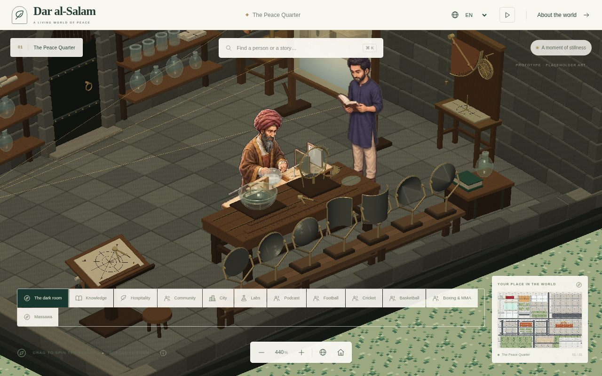
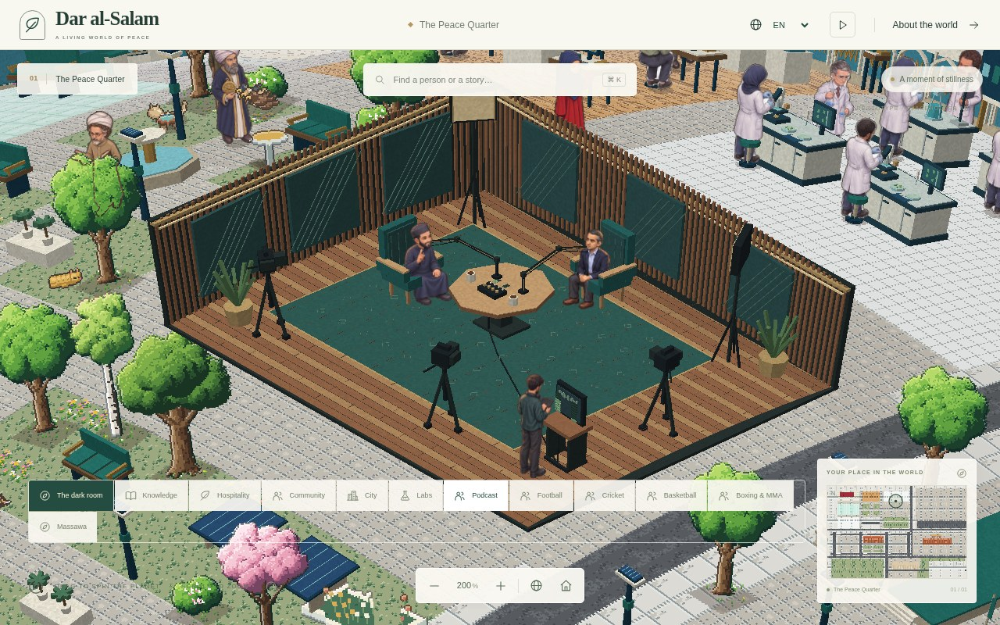

# Ibn al-Haytham and the scene exchange

The scholar now has a detailed mature face, dimensional cloth, a burgundy
wrapped turban, a salt-and-pepper beard and layered chestnut/rust robes in the
owner's saved isometric pixel-art style. The dark room occupies the former
podcast lawn; the complete Omar Suleiman / Mehdi Hasan studio occupies the
former dark-room plot beside Community.

[Watch the native animation preview](previews/haytham-redesign-and-scene-swap.mp4).

## Visual references

- The owner's unmodified `ibn-al-haytham.png` from Isometric Character Sprites
  Parts 1 and 2 is preserved in
  `art/sprites/source/haytham-redesign/original/owner-style-reference.png`.
  The bundled Mufti Menk reference supplies the same pixel material treatment.
- A later illustrated portrait was downloaded and visually inspected from
  [this public educational repository](https://github.com/amzubair/freecodecamp-tribute-page/blob/6b724959a85faeb8eac321f260a78378afcae71c/images/ibn-al-haytham%402x.png).
  Its arched brows, long nose, wrapped turban and long beard informed the
  redesign. The repository does not establish the illustrator or a verified
  historical likeness, so the source image is linked rather than redistributed.
- Additional tribute pages were inspected for references, including
  [a page identifying a later Hevelius frontispiece](https://github.com/Morched23MJ/tribute-page/blob/master/index.html).
  That off-site image and Wikipedia/Wikimedia image hosts were unavailable under
  this environment's network policy; they were not used as visually verified
  references. No lifetime photographs exist for this medieval scholar.

The result is an illustrative historical interpretation. All names, aliases,
biography placeholders, sources and advisory approval fields remain intact.

## Animation and preservation

Every original still, illustration, gallery image, front/rear animation strip,
character script and articulated pose-control file is archived under
`art/sprites/source/haytham-redesign/original/`, with SHA-256 inventory entries.
The 120-tick experiment retains all 40 playback cells at three ticks per cell:
aperture/shutter, glass bowl, measuring dial, compass drawing, and watching the
inverted image. The cells are redrawn to the new design; this is not a claim
that the runtime pixels remain identical to the old art.

The technical importer crops and registers generated artwork against the fixed
bench post and far edge, removes the background matte, retains the original
344 × 395 cell dimensions, (138, 299) anchor and 4.6 density, and updates the
portrait/gallery. No face is procedurally drawn. Front and rear standing stills
are distinct; the original shared front/rear action fallback is retained.
These actions are volumetric-looking pixel sprites, rather than a new rigged
character mesh. The room and its instruments remain actual native 3D geometry.

## Moving complete scenes

The old plot centers exchange exactly: optics moves from (47, 30.96) to
(22, 106), and the studio moves from (22, 106) to (47, 30.96). The chamber keeps
its 0.85 uniform scale and its original architecture and instrument meshes.
All 24 approved source files remain byte-identical.

Podcast seats, microphones, three recording cameras, monitor cart, lights,
table, plants, speakers and operator now derive from one translated origin.
The optics assistant uses the chamber transform. Scene bounds, focus buttons,
camera station targets and collision walls follow their respective scenes.
The migration retains existing object IDs and restores other solid collisions
after clearing the old studio walls; rerunning it does not duplicate the set.

Reproduce the art import with `node tools/prepare-haytham-redesign.mjs` and the
layout migration with `node --import tsx tools/swap-optics-and-podcast.ts`.
Neither command regenerates unrelated world art or approves draft characters.

## Verification and preview

The unit suite checks the scene centers, attached staff, collision migration,
source archive hashes, 40 distinct cells per facing, exact playback metadata,
closed scripts and preserved draft identities. Native browser checks cover the
room, its experiments, podcast performers, recording equipment and pause.

The preview at `docs/previews/haytham-redesign-and-scene-swap.mp4` is captured
from the native world renderer and shows the full experiment followed by both
relocated scenes. It is not a source-sheet slideshow.

Validation: 149 unit tests and 24 browser tests passed; type checking, ESLint
and `pnpm build:preview` passed. The approved-source check verified all 24
unchanged dark-room files, and asset preparation reported zero warnings.

The native capture reached all 40 scholar poses without runtime errors. The
34-second preview has 816 frames at 24 fps, measures 1104 × 690 pixels, and is
1,929,461 bytes. A complete FFmpeg decode passed. Its SHA-256 is
`ac2824df0f140ad13d4901261a1cc39fa9960a6883a215779fee651aef9cb72d`.
